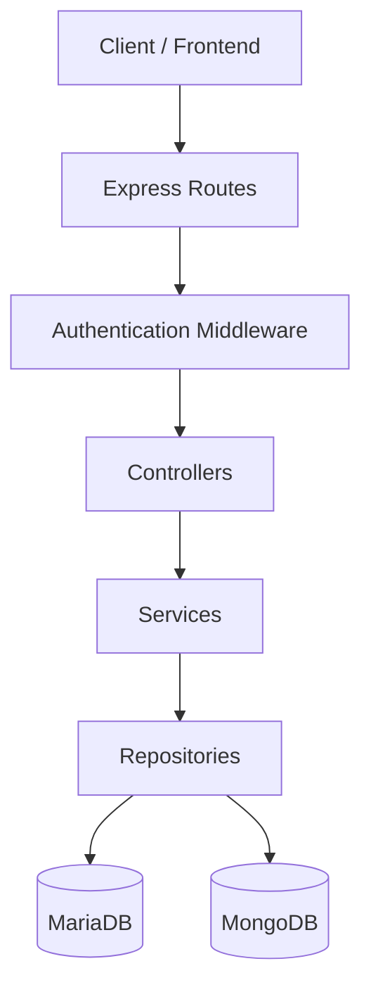

# ALOKI Messenger API

> **A backend-focused messaging platform built with TypeScript, Express, MariaDB, and MongoDB.**
>
> ALOKI Messenger is an API project focused on structured backend engineering: session-based authentication, account security, private conversations, message lifecycle operations, and a deliberately separated persistence model.

<p align="center">
  <strong>◆ TypeScript</strong> &nbsp;·&nbsp;
  <strong>◆ Express 5</strong> &nbsp;·&nbsp;
  <strong>◆ MariaDB</strong> &nbsp;·&nbsp;
  <strong>◆ MongoDB</strong>
</p>


<div align="center">

## Programming Languages


## Runtime & Backend Frameworks


## Databases & Data Storage


## Architecture & Design Patterns


## Authentication & Security


## Libraries & Packages


## DevOps & Infrastructure


## Development & Testing Tools


</div>

---

## ◈ Overview

ALOKI Messenger API is a TypeScript REST API for user accounts and private messaging. It combines a relational database for structured account and conversation data with a document database for message records.

The project is designed around clear responsibilities:

- **Authentication and account security** — registration, email verification, password hashing, opaque session keys, temporary and permanent sessions, two-step email verification, password recovery, and account/profile management.
- **Private messaging** — conversation creation and retrieval, message sending, replies, editing, soft deletion, and cursor-based message pagination.
- **Separated persistence** — MariaDB manages relational entities and membership; MongoDB stores message documents.
- **Operational lifecycle** — explicit database connection checks, startup sequencing, terminal status output, and graceful shutdown handling.
- **Project identity verification** — an Ed25519 signature verifies the project's signed identity metadata during startup.

This repository is an API implementation. It does not currently provide a frontend, WebSocket transport, or real-time message delivery.

## ◆ Core capabilities

### Account and authentication

| Capability | Implementation |
|---|---|
| Registration | Email-based registration with a verification step |
| Login | Username or email and password |
| Password storage | bcrypt password hashing |
| Session model | Random opaque session keys |
| Session persistence | SHA-256 session-key hashes stored in MariaDB |
| Session levels | Temporary and permanent sessions |
| Two-step verification | Email verification code during login |
| Password recovery | Email code verification followed by password replacement |
| Password update | Current-password verification before changing the password |
| Email update | Verification-code workflow |
| Profile | Retrieve and update profile fields |
| Avatar | Multipart image upload through Multer |
| Account deletion | Authenticated account deletion endpoint |

### Messaging

| Capability | Implementation |
|---|---|
| Conversations | Private one-to-one conversations |
| Conversation listing | Retrieve conversations for the authenticated user |
| Message creation | Send a text message to a conversation |
| Replies | Reference an earlier message in the same conversation |
| Reply preview | Return the referenced message preview with retrieved messages |
| Editing | Only the original sender can edit their message |
| Deletion | Soft deletion; the message record remains in MongoDB |
| Pagination | Cursor-based pagination using MongoDB ObjectIds |
| Access control | Permanent session and conversation membership required |

## ▣ Technology stack

### Runtime and application

- **Node.js** — JavaScript runtime.
- **TypeScript 6** — static typing and strict compiler checks.
- **Express 5** — HTTP application and routing.
- **ES Modules** — native module syntax with Node's `NodeNext` TypeScript configuration.
- **tsx** — TypeScript execution during development.
- **Nodemon** — restarts the development process when files change.

### Data and persistence

- **MariaDB** — users, sessions, verification records, conversations, and conversation membership.
- **MongoDB** — message documents and message-oriented queries.
- **mysql2** — MariaDB connection pool and parameterized queries.
- **mongodb** — official MongoDB Node.js driver.

### Security, email, and file handling

- **bcrypt** — password and verification-code hashing.
- **Node.js crypto** — cryptographically secure random values, SHA-256 hashing, and Ed25519 signature verification.
- **Nodemailer** — email delivery through the configured Gmail transport.
- **Multer** — multipart avatar upload handling.
- **cookie-parser** — parsing incoming cookies.
- **cors** — Cross-Origin Resource Sharing middleware.
- **dotenv** — loading environment variables.

### Testing and development packages

- **Vitest** — test runner.
- **Supertest** — HTTP assertion/testing utility.
- **ts-node** — TypeScript execution support.
- **tsx** — TypeScript runtime used by the development script.
- **TypeScript** — compiler and type checker.
- **@types packages** — TypeScript declarations for the corresponding libraries.

> Package presence and active usage are not the same thing. For example, `jsonwebtoken` and `@types/jsonwebtoken` are listed in the package manifest, but the authentication flow shown in this codebase uses opaque session keys rather than JWTs.

## ◈ Architecture

The application uses a layered structure to separate HTTP concerns, business rules, and data access.



### Request lifecycle

1. A client sends an HTTP request.
2. Express routes direct the request to the relevant controller.
3. Protected routes execute authentication middleware before the controller.
4. Controllers extract request data and authenticated user context.
5. Services enforce business rules, validate inputs, and coordinate operations.
6. Repositories perform database operations.
7. The controller returns a consistent JSON response.
8. Errors are forwarded to the centralized error middleware.

### Why use layers?

The separation keeps responsibilities focused:

- **Routes** define the HTTP method, path, and middleware chain.
- **Controllers** translate HTTP requests into service calls and responses.
- **Services** contain application rules and coordinate data operations.
- **Repositories** isolate database queries and persistence details.
- **Models and types** describe the data structures used across the application.
- **Middleware** handles cross-cutting concerns such as authentication, uploads, and errors.

This structure makes it easier to change persistence details without mixing database logic into HTTP handlers.

## ◈ Dual-database design

The project does not force every kind of data into one database. It uses each database for the responsibilities it handles well.

### MariaDB — relational data

MariaDB is responsible for data that benefits from relational constraints and joins:

- User accounts and profile information
- Password hashes and account security settings
- Session records and session expiration
- Verification-code records
- Conversations
- Conversation membership

Private conversations are represented by a relational conversation record and membership records. A normalized `pairKey` is generated from the two user IDs, so the same pair maps to the same private-conversation identity regardless of which user initiates the request.

The repository also handles a duplicate-entry race by checking for an existing conversation after a conflicting insert.

### MongoDB — message documents

Messages are stored in the `messages` collection. A message document has this general shape:

```json
{
  "_id": "MongoDB ObjectId",
  "conversationId": 42,
  "senderId": 7,
  "body": "Hello!",
  "replyTo": null,
  "createdAt": "2026-01-01T12:00:00.000Z",
  "editedAt": null,
  "deletedAt": null
}
```

The values above are illustrative. MongoDB stores `createdAt`, `editedAt`, and `deletedAt` as dates, and `replyTo` as an ObjectId reference or `null`.

The message repository creates a compound index:

```javascript
{ conversationId: 1, _id: -1 }
```

This index supports retrieving messages for a conversation in descending ObjectId order.

### Why separate conversations and messages?

Conversation membership is relational: users belong to conversations, and membership must be checked before a user can access messages. Message records are document-oriented and are queried primarily by conversation and message identifier.

Keeping these responsibilities separate avoids turning the message collection into a substitute for relational membership management.

## ◆ Authentication and session security

The authentication design uses a random opaque session key instead of placing user identity and claims inside a JWT.

### Session creation

When a session is created:

1. The server generates a cryptographically secure random value using `crypto.randomBytes(32)`.
2. The raw key is returned to the client in an HTTP-only cookie.
3. The server hashes the key with SHA-256.
4. Only the hash is stored in the MariaDB `sessions` table.
5. On authenticated requests, the cookie value is hashed again and looked up against an unexpired database session.

The raw session key is therefore not stored in the database.

```ts
const sessionKey = crypto.randomBytes(32).toString("hex");

const sessionKeyHash = crypto
  .createHash("sha256")
  .update(sessionKey)
  .digest("hex");
```

### Temporary and permanent sessions

The application distinguishes between two session types:

- **Temporary session** — used during the second step of a login that requires email verification.
- **Permanent session** — grants access to protected account and messaging operations.

Messaging services explicitly require a permanent session. A temporary session cannot create conversations or send, edit, delete, or retrieve messages.

### Cookie configuration

Session cookies are configured with:

- `httpOnly: true`
- `sameSite: "lax"`
- `secure` enabled when `NODE_ENV` is `production`
- A one-hour cookie lifetime for the session cookie

The verification cookies use the shared base cookie options and their own expiration settings.

### Password handling

Passwords are hashed with bcrypt using a work factor of `10`. Password comparison uses bcrypt verification rather than comparing raw password values.

> **Deployment note:** production deployments should configure HTTPS, restrict CORS to trusted frontend origins, and add appropriate request-rate limiting and operational monitoring.

## ◆ Messaging system

Messaging is implemented as a REST workflow over private conversations.

### 1. Create or retrieve a private conversation

The client submits the target user's ID. The service validates the target, rejects invalid IDs and self-conversations, checks that the target account exists, and asks the conversation repository to find or create the private conversation.

A normalized pair key prevents the same two users from creating separate private conversations merely by reversing their order.

### 2. Send a message

A message request includes a text body and may optionally include a `replyTo` message ObjectId.

Before insertion, the service checks:

- The user has a permanent session.
- The conversation exists and the user is a member.
- The body is a string and is not empty after trimming.
- The body does not exceed 4,000 characters.
- If `replyTo` is provided, it is a valid ObjectId and refers to a non-deleted message in the same conversation.

The repository then inserts a MongoDB document with creation and lifecycle timestamps.

### 3. Retrieve messages

Message retrieval supports:

- A default page size of 50.
- A maximum page size of 100.
- An optional `before` cursor containing a MongoDB ObjectId.
- A `nextCursor` in the response when another page may be available.

The query filters by conversation and, when a cursor is provided, retrieves documents whose `_id` is less than the cursor. Results are sorted in descending order.

Reply references are resolved in a separate batch query. The response includes a `replyToMessage` preview for each message rather than requiring the client to make an additional request for every reply.

### 4. Edit a message

Editing requires permanent authentication, conversation membership, a valid message ID, and a valid non-empty body within the message-length limit.

The database update filters by message ID, conversation ID, sender ID, and `deletedAt: null`. This means a user cannot edit another user's message, and a deleted message cannot be edited through this operation.

The `editedAt` timestamp is updated when the edit succeeds.

### 5. Delete a message

Deletion is a **soft delete**. The message document is retained, its body is replaced with an empty string, and `deletedAt` is set.

This preserves the record and allows reply previews to display a deleted-message placeholder. The operation is restricted to the original sender and the conversation in which the message exists.

## ⌘ API reference

All routes below are mounted by the Express application. Protected routes require a valid session cookie.

### Authentication and account

| Method | Endpoint | Purpose | Authentication |
|---|---|---|---|
| `POST` | `/register` | Start email-based registration | No |
| `POST` | `/login` | Log in with username/email and password | No |
| `POST` | `/verifyCode/register` | Verify registration code and create account | Verification cookie |
| `POST` | `/verifyCode/login` | Complete two-step login verification | Temporary session |
| `POST` | `/forgotPassword/sendemail` | Request a password-reset code | No |
| `POST` | `/forgotPassword/sendcode` | Verify password-reset code | Reset cookie |
| `POST` | `/forgotPassword/sendnewpassword` | Set a new password after verification | Reset cookie |
| `POST` | `/updatepassword` | Change the current password | Yes |
| `POST` | `/update_email` | Start email-change verification | Yes |
| `POST` | `/verifyCode/update_email` | Verify and apply the new email | Yes |
| `PATCH` | `/two-factor` | Toggle email-based two-step verification | Yes |
| `GET` | `/profile` | Retrieve the authenticated user's profile | Yes |
| `PATCH` | `/updateProfile` | Update profile fields and optional avatar | Yes |
| `DELETE` | `/delete_account` | Delete the authenticated user's account | Yes |

### Conversations and messages

| Method | Endpoint | Purpose | Authentication |
|---|---|---|---|
| `POST` | `/conversations` | Create or retrieve a private conversation | Permanent |
| `GET` | `/conversations` | List the user's private conversations | Permanent |
| `POST` | `/conversations/:conversationId/messages` | Send a message | Permanent |
| `GET` | `/conversations/:conversationId/messages` | Retrieve a page of messages | Permanent |
| `PATCH` | `/conversations/:conversationId/messages/:messageId` | Edit the sender's message | Permanent |
| `DELETE` | `/conversations/:conversationId/messages/:messageId` | Soft-delete the sender's message | Permanent |

### Example: create a conversation

```http
POST /conversations
Content-Type: application/json
Cookie: session_7=<session-key>
```

```json
{
  "targetUserId": 12
}
```

### Example: send a message

```http
POST /conversations/42/messages
Content-Type: application/json
Cookie: session_7=<session-key>
```

```json
{
  "body": "Hey, how are you?"
}
```

### Example: reply to a message

```json
{
  "body": "I'm doing well, thanks.",
  "replyTo": "65a1b2c3d4e5f67890123456"
}
```

### Example: retrieve messages

```http
GET /conversations/42/messages?limit=50
```

To request an older page, pass the `nextCursor` from the previous response:

```http
GET /conversations/42/messages?limit=50&before=65a1b2c3d4e5f67890123456
```

The response contains a `messages` array and a `nextCursor` value. A `null` cursor indicates that the current result did not produce another page.

### Example: edit a message

```http
PATCH /conversations/42/messages/65a1b2c3d4e5f67890123456
Content-Type: application/json
```

```json
{
  "body": "Updated message content."
}
```

### Example: delete a message

```http
DELETE /conversations/42/messages/65a1b2c3d4e5f67890123456
```

### Response format

Successful responses use a shared response helper and follow this general structure:

```json
{
  "success": true,
  "message": "Message sent",
  "data": {
    "message": {}
  }
}
```

Error responses use the centralized error middleware:

```json
{
  "success": false,
  "message": "Conversation not found"
}
```

The exact `data` fields depend on the endpoint.

## ◈ Profile and avatar uploads

Profile updates support `fullname`, `username`, `bio`, and an optional avatar file.

The avatar endpoint accepts `multipart/form-data` with the file field named `avatar`. Multer stores accepted files under `uploads/`, and the application serves that directory through `/uploads`.

Current upload configuration:

- Maximum file size: 2 MB.
- Accepted files: files whose reported MIME type starts with `image/`.
- Filename: timestamp-prefixed original filename.

The API stores the resulting relative upload path in the user's profile.

> The current upload filter checks the supplied MIME type. It does not perform content-based file-signature inspection. A production deployment should add stronger file validation and safe filename handling.

## ◈ Startup and shutdown lifecycle

The server startup sequence is explicit:

1. Verify the signed project identity.
2. Connect to MongoDB.
3. Create the message collection index.
4. Connect to MariaDB and run a connectivity query.
5. Start the HTTP server on port `4000`.
6. Display the online status in the terminal.

The terminal loader displays progress while startup steps are running.

### Graceful shutdown

The process listens for `SIGINT` and `SIGTERM`. During shutdown it:

1. Prevents duplicate shutdown execution.
2. Stops accepting new HTTP connections through the server close operation.
3. Waits for active HTTP connections to close.
4. Uses a 10-second timeout before forcing remaining HTTP connections closed.
5. Closes the MariaDB pool and MongoDB client.
6. Sets the process exit code based on cleanup results.

This lifecycle keeps HTTP and database cleanup explicit instead of relying on abrupt process termination.

## ◆ Digitally signed project identity

The project includes a small identity-verification mechanism based on **Ed25519** signatures.

The signed identity metadata contains:

```json
{
  "author": "ALOKI",
  "signature": "ALOKI-MESSENGER-2026",
  "version": "1.0.0"
}
```

The signature is generated outside the normal application request flow. At startup, the application reads the identity payload, loads the public key, and verifies the signature using Node.js's built-in cryptographic APIs.

### Key separation

- The **private key** is used by the signing script and should remain outside the repository.
- The **public key** is included in the project so the application can verify the signature.
- The signed identity metadata and signature are stored in `src/config/project-signature.json`.

The private signing key is intentionally not part of the source tree. Keep it protected and do not commit it.

### What this verification does — and does not do

It verifies that the identity metadata matches the signature produced by the corresponding private key, assuming the public key and verifier are trusted.

It is **not** a complete source-code integrity system, DRM, or tamper-proof mechanism. A person who can modify the source can also remove the verifier or replace the embedded public key. The mechanism is intended as a project identity/signature feature, not as a guarantee that every source file is unmodified.

## ▣ Project structure

```text
messenger-api-v1.2/
├── server.ts
├── package.json
├── tsconfig.json
├── src/
│   ├── app.ts
│   ├── config/
│   │   ├── projectIdentity.ts
│   │   ├── project-public.pem
│   │   └── project-signature.json
│   ├── controllers/
│   │   ├── authController/
│   │   ├── chat/
│   │   ├── deleteAccount/
│   │   ├── forgotpassController/
│   │   ├── profileController/
│   │   ├── twoFactorController/
│   │   ├── updateEmailController/
│   │   ├── updatePasswordController/
│   │   ├── updateProfileController/
│   │   └── verifi2FAController/
│   ├── db/
│   │   └── mongodb.ts
│   ├── db.ts
│   ├── errors/
│   │   ├── AppError.ts
│   │   └── index.ts
│   ├── middleware/
│   │   ├── authMiddleware.ts
│   │   ├── errorMiddleware.ts
│   │   ├── uploadMiddleware.ts
│   │   └── verificationRegisterMiddleware.ts
│   ├── models/
│   │   ├── conversation.model.ts
│   │   └── message.model.ts
│   ├── repositories/
│   │   ├── chat/
│   │   │   ├── conversationRep.ts
│   │   │   └── messageRep.ts
│   │   ├── userRepositories.ts
│   │   └── verification.ts
│   ├── routes/
│   │   ├── auth/
│   │   ├── chat/
│   │   ├── deleteAccount/
│   │   ├── forgotpass/
│   │   ├── profile/
│   │   ├── twoFactor/
│   │   ├── updateEmail/
│   │   ├── updatePassword/
│   │   ├── updateProfile/
│   │   ├── users.ts
│   │   └── verifi2FA/
│   ├── services/
│   │   ├── authService/
│   │   ├── chat/
│   │   ├── forgotPassword/
│   │   ├── updateEmailService/
│   │   ├── updatePasswordService/
│   │   ├── updateProfileServices/
│   │   └── verificationService/
│   ├── types/
│   │   ├── chat.types.ts
│   │   ├── express.d.ts
│   │   └── user.ts
│   └── utils/
│       ├── checkUndefined.ts
│       ├── cookieOptions.ts
│       ├── hashPassword.ts
│       ├── sendVerificationCode.ts
│       ├── sessionCookies.ts
│       ├── SessionCookie.ts
│       ├── sessionKeyHash.ts
│       ├── sessionToken.ts
│       ├── SetVerificationCookie.ts
│       ├── successResponse.ts
│       ├── terminalLoader.ts
│       └── verifyProjectIdentity.ts
└── uploads/
```

The tree above groups related files by directory to keep the overview readable. The repository contains additional implementation files inside the listed controller, route, and service directories.

## ⌘ Installation and local setup

### Requirements

- Node.js with support for the project's TypeScript/ESM runtime.
- npm.
- A running MariaDB instance.
- A running MongoDB instance.
- An email account configured for the Nodemailer transport.

### 1. Clone the repository

```bash
git clone <your-repository-url>
cd messenger-api-v1.2
```

### 2. Install dependencies

```bash
npm install
```

### 3. Configure environment variables

Create a `.env` file in the project root:

```env
NODE_ENV=development

DB_HOST=127.0.0.1
DB_USER=your_mariadb_user
DB_PASSWORD=your_mariadb_password
DB_NAME=messenger

MONGO_URI=mongodb://127.0.0.1:27017
MONGO_DB=messenger

MAIL_USER=your_email@gmail.com
MAIL_PASSWORD=your_email_app_password
```

Use an app password or an appropriate provider credential for the email account. Do not commit `.env` files, database passwords, email credentials, or private signing keys.

### 4. Prepare the databases

Create the MariaDB database and the tables expected by the application, and make sure MongoDB is reachable using `MONGO_URI` and `MONGO_DB`.

The application creates the message collection index during startup. The supplied source does not include database migration files, so the relational schema must be prepared separately before the API can be used.

The code expects relational tables for users, sessions, verification codes, conversations, and conversation members.

### 5. Start the development server

```bash
npm run dev
```

The HTTP server listens on port `4000`.

### 6. Run the test script

```bash
npm test
```

Vitest is configured as the test runner. Actual test coverage depends on the test files present in the repository.

## ◆ Package inventory

The following is the complete package inventory from the supplied `package.json`.

### Runtime dependencies

| Package | Role |
|---|---|
| `bcrypt` | Password and code hashing |
| `cookie-parser` | Parse request cookies |
| `cors` | Configure cross-origin request handling |
| `dotenv` | Load environment variables |
| `express` | HTTP server and routing |
| `jsonwebtoken` | JWT library present in dependencies; not used by the supplied session-authentication flow |
| `mongodb` | MongoDB Node.js driver |
| `multer` | Multipart file upload handling |
| `mysql2` | MariaDB/MySQL driver and connection pool |
| `nodemailer` | Email delivery |
| `nodemon` | Development process restart utility |

### Development and type dependencies

| Package | Role |
|---|---|
| `@types/bcrypt` | bcrypt type declarations |
| `@types/cookie-parser` | cookie-parser type declarations |
| `@types/cors` | cors type declarations |
| `@types/express` | Express type declarations |
| `@types/jsonwebtoken` | jsonwebtoken type declarations |
| `@types/multer` | Multer type declarations |
| `@types/node` | Node.js type declarations |
| `@types/nodemailer` | Nodemailer type declarations |
| `@types/supertest` | Supertest type declarations |
| `supertest` | HTTP endpoint testing utility |
| `ts-node` | TypeScript execution support |
| `tsx` | TypeScript runtime used by the development command |
| `typescript` | TypeScript compiler and type system |
| `vitest` | Test runner |

## ◈ TypeScript configuration

The project uses a strict, no-emit TypeScript configuration with Node's ESM-oriented module resolution.

Key compiler options:

- `target: "esnext"`
- `module: "nodenext"`
- `rewriteRelativeImportExtensions: true`
- `erasableSyntaxOnly: true`
- `verbatimModuleSyntax: true`
- `noEmit: true`
- `strict: true`
- `skipLibCheck: true`

The application is executed through `tsx` during development rather than emitting compiled JavaScript files through `tsc`.

## ◆ Engineering decisions

### Opaque sessions instead of JWT-based authentication

The session key is random, opaque, revocable through the database, and not a self-contained token carrying user claims. The database remains the authority for session validity and expiration.

### Relational and document storage are separated by responsibility

MariaDB manages users and conversation membership. MongoDB stores message documents and supports message-oriented retrieval and pagination.

### Authorization is checked at the service boundary

Messaging services require a permanent session and verify conversation membership before operating on messages. Message updates and deletion also filter by sender ID at the repository level.

### Message deletion preserves the record

Soft deletion retains the message document and its lifecycle timestamp instead of physically removing the record.

### Startup and shutdown are treated as application responsibilities

Database connections, index initialization, HTTP startup, signal handling, and resource cleanup are explicit parts of the server lifecycle.

## ◈ Current scope and future direction

The current implementation focuses on the REST API and private text messaging.

The following capabilities are **not implemented in the supplied source**:

- Real-time delivery through Socket.IO or WebSockets
- Redis integration
- Group conversations
- Message attachments
- Read receipts or delivery receipts
- Typing indicators and online presence

These are possible future extensions, not current project features.

## ◆ Project evolution

The project continues the earlier JavaScript messenger API with a more explicit TypeScript architecture and an expanded backend feature set.

| Area | Earlier direction | Current implementation |
|---|---|---|
| Language | JavaScript | TypeScript with strict checking |
| Authentication | JWT-oriented approach | Opaque database-backed session keys |
| Session storage | Token-centric | SHA-256 session-key hashes in MariaDB |
| Account security | Basic authentication flow | Email verification, temporary/permanent sessions, two-step login, and password recovery |
| Data persistence | Earlier single-project data model | MariaDB for relational data and MongoDB for messages |
| Messaging | Initial messaging foundation | Private conversations, replies, edits, soft deletion, and cursor pagination |
| Structure | Less explicit separation | Routes, controllers, services, repositories, models, and shared utilities |
| Operations | Basic server startup | Explicit connection checks, startup sequence, and graceful shutdown |
| Project identity | — | Ed25519-signed identity metadata verification |

## License

This project currently declares the `ISC` license in `package.json`. See the repository's license file, if present, for the authoritative license text.
